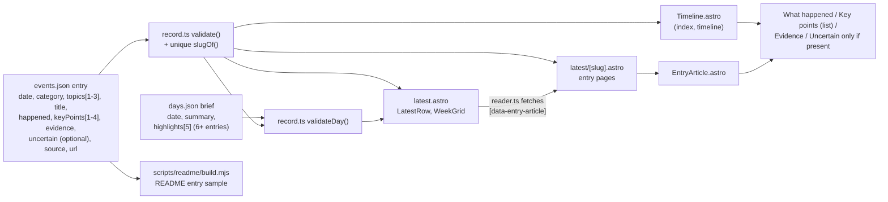

# Architecture

> System flow, auth strategy, state management, cross-cutting structure. Keep it terse: pointers into code, not essays.

## Output

- Static site: `astro.config.mjs` sets `output: 'static'`, `site: 'https://safeai.watch'`. No server code, no auth. The record is read at build time; the only runtime fetch is the /latest reader (`src/scripts/latest/reader.ts`) loading prebuilt `/latest/<slug>/` entry pages from the same origin.
- Pages: `src/pages/index.astro` (home), `about.astro`, `latest.astro`, `latest/[slug].astro` (one page per entry), `timeline.astro`, `privacy.astro`.
- Layouts: `src/layouts/BaseLayout.astro` (fonts, `src/styles/global.css`, inlined `tokens.css`, `SiteNav`, `SiteFooter`); `PageLayout.astro` wraps it for the inner pages.

## The record

- Data: `src/data/events.json`, an array of entries with exactly the keys `date`, `category`, `topics` (1 to 3 of `TOPICS`, placed after `category`), `title`, `happened`, `keyPoints` (1 to 4 strings), `evidence`, `source`, `url`, plus an optional `uncertain`.
- `src/data/record.ts` validates every entry at build time and throws on a missing, empty or extra key, an empty or overlong `keyPoints` list, a malformed date, a category outside `CATEGORIES` (Research, Incidents, Warnings, Governance), a `topics` list that is empty, longer than 3, repeated or outside `TOPICS` (Bio, Cyber, Rogue agents, Alignment, Superintelligence, Harm to people, Military, Lab conduct; display order), or a non-https `url`. It also throws when two entries share a slug.
- `slugOf(event)`: `<date>-<title slug>`, the title lowercased, accents stripped, other characters collapsed to `-`, cut at a `-` by 60 characters. Used for `/latest/<slug>/` and `?entry=`.
- Day briefs: `src/data/days.json`, one `{ date, summary, highlights? }` per date. The site renders only `highlights`; `summary` is validated but not shown. `record.ts` requires a brief for every date with 3 or more entries (a module-level loop over `entriesByDate`, run after the briefs are validated). `validateDay()` rejects a brief on a date with fewer entries and checks each brief's fields: a summary of one or two sentences, at most 320 characters, no em dash; `highlights` (Five to read) exactly when the date has 6 or more entries, as 5 distinct slugs of that date's entries; and the Bio rule (every Bio entry highlighted, or all five highlights Bio when there are more than five).
- Exports: `events` (oldest first), `eventsNewestFirst`, `lastUpdated` (date of the newest entry), `CATEGORIES`, `TOPICS`, `slugOf`, `groupByDay` (entries by date, newest date first), `dayBriefs` (Map by date) and the date formatters.
- Editorial rules for topics and day briefs: `.claude/skills/add-source/references/topics.md` (daily-watch follows it).
- Consumers: `src/pages/index.astro` (`events`, `lastUpdated`), `src/pages/latest.astro` (`eventsNewestFirst`, `groupByDay`, `dayBriefs`, `slugOf`), `src/pages/latest/[slug].astro` (`events`, `slugOf`), `src/components/WeekGrid.astro` (`events`, `TOPICS`, `CATEGORIES`, `lastUpdated`), `LatestRow.astro` and `EntryArticle.astro` (`slugOf`), `src/components/Timeline.astro` (used by `index.astro` and `timeline.astro`), `src/components/SiteFooter.astro` (`lastUpdated`).
- `Timeline.astro` renders every tab and panel at build time; its client script only switches the selected one.

## /latest reader

- `src/pages/latest.astro`: header, `WeekGrid`, then two panes. Left, the list: days from `groupByDay(eventsNewestFirst)`, each a `[data-day]` section with "Five to read" (`LatestRow highlight`) and the rest in `[data-day-rest]`, plus type chips (`[data-type-chip]`) and the filter status line. Right (1024px and wider), `[data-reader-pane]` with the newest entry rendered at build through `EntryArticle`. Narrower, the pane is hidden and headlines are links.
- `src/components/LatestRow.astro`: one row, headline linking to `/latest/<slug>/`. Data hooks: `data-entry`, `data-slug`, `data-date`, `data-type` (category lowercased), `data-topics` (topic slugs, space-separated), `data-highlight`.
- `src/pages/latest/[slug].astro`: entry page on `BaseLayout`, `EntryArticle` with the title as h1, link back to `/latest/?entry=<slug>`. `src/components/EntryArticle.astro` (`[data-entry-article]`) renders the entry in full, topics included; shared with the /latest pane.
- `src/scripts/latest/reader.ts`: collapses each busy day to its highlights (`[data-day-toggle]`), selects the row named by `?entry=` (else the newest) and keeps `?entry=` current with `replaceState`. At 1024px and wider a plain left click fetches `/latest/<slug>/`, takes its `[data-entry-article]` (h1 turned into h2) and swaps it into the pane; a failed fetch navigates to the entry page. Back/forward reselects.
- `src/components/WeekGrid.astro`: topics by the 7 days of one week, weeks being 7-day blocks ending on `lastUpdated`; a dot's area grows with the count, per-type counts ride on `data-n-<type>`. Only week 0 is rendered at build, with every button disabled until the script runs.
- `src/scripts/latest/filters.ts`: enables the grid, builds earlier weeks in the browser by cloning the week 0 panel and filling it from the list rows' `data-date`, `data-topics` and `data-type`, and steps weeks (`[data-week-prev]`, `[data-week-next]`). Topic labels, cells and day headers filter by topic, topic and day, or day; the type chips add a type. While a filter is on, `.reader-list[data-filtering]` shows every match, hides days with none and counts "N of M entries". State lives in the URL as `topic`, `day` and `type` (`pushState`, restored on load and back/forward).

## About film

- `src/components/FilmPlayer.astro`, mounted by `src/pages/about.astro`: a 1920x1080 canvas, transport controls, text captions for narrow players and a transcript, all built from `film/beats.json`.
- `src/scripts/film/player.js` owns the clock, controls and page lifecycle; animation frames run only while the film plays and is on screen. No audio.
- Engine `src/scripts/film/engine/`: `film.js` is `frame(t)`, a pure function of time (no frame-to-frame state, no `Math.random()`), so seeking gives the same pixels. `world.js` draws the chart, `captions.js` the text layer (strings only from `beats.json`), `camera.js`, `palette.js`, `draw.js` (canvas 2D primitives), `util.js`, `logo-g3.js` (generated mark geometry, do not edit).
- `scripts/film/lint-beats.mjs` checks `beats.json` against `film/facts.md` and `film/SCRIPT.md` before every build (`prebuild`). `scripts/film/export-video.mjs` and `check-export.mjs` export and check a video of the film; they are not part of the build.

## Homepage visuals (WebGL2)

- Mount: `src/components/VisualSlot.astro` with `name` = `hero`, `sequence`, `record`, `coverage` or `closing`, all placed in `src/pages/index.astro`. Each slot ships a build-time SVG still as the fallback.
- `src/scripts/visuals/runtime.ts` (`mountVisuals()`, called from `VisualSlot`): lazy-loads the named scene module when the slot comes within 300px of the viewport, gives it a WebGL2 canvas (DPR capped at 2), runs the loop only while on screen and the tab is visible, draws one static frame under reduced motion, and keeps the SVG still when WebGL2 is missing.
- Scenes: `hero.ts`, `sequence.ts`, `record.ts`, `coverage.ts`, `closing.ts`. Shared: `shapes.ts` (instanced line, circle and fill batcher), `backdrop.ts` (background field and grain pass for the dark scenes).
- `sequence.ts` reads reading progress from the `seq:progress` event dispatched by the inline script in `index.astro`.
- The scenes draw from seeded random geometry; none imports the record.

## Brand

- `npm run brand` runs `scripts/brand/build-brand.mjs`, which takes the mark geometry from `scripts/brand/valley.mjs` and colours from `src/styles/tokens.css`. It writes the logo SVGs to `src/assets/brand/`, the favicons, app icons, `site.webmanifest` and `og-image.png` to `public/`, and the Newsreader italic subset to `src/assets/fonts/`. Outputs are committed; the site build does not run it.
- `src/components/Mark.astro` inlines `mark-small.svg` below 48px and loads `mark.svg` at 48px and up.
