<!-- generated by scripts/readme/build.mjs. do not edit by hand. -->

<picture>
<source media="(max-width: 500px) and (prefers-color-scheme: dark)" srcset="assets/readme/masthead-narrow-dark.svg">
<source media="(max-width: 500px)" srcset="assets/readme/masthead-narrow-light.svg">
<source media="(prefers-color-scheme: dark)" srcset="assets/readme/masthead-dark.svg">

</picture>

**[SafeAI.watch](https://safeai.watch)** is a public record of AI safety and security for general readers: research, reported incidents, public warnings and policy responses. Each entry links its original source, gives its key points, and separates what happened from what the evidence shows.

The record holds 327 entries from Mar 22, 2023 to Oct 26, 2026 (73 warnings, 79 incidents, 95 governance, 80 research), drawn from 184 publishers. It is a selection, not a complete count: the burst above shows what the record covers, so its dense rim is no measure of how often such events happen. Read it on the site: [Latest](https://safeai.watch/latest), [Timeline](https://safeai.watch/timeline), [About](https://safeai.watch/about).

## How an entry reads

Every entry sets out what happened, the source's key points and what the evidence shows, and adds what remains uncertain when something material is still open. The newest one, from Oct 26, 2026, filed under Research:

> **UK AI Security Institute finds coding agents rebuild parts of biological AI tools from published details**
>
> **What happened.** The UK AI Security Institute's Chem-Bio team published results on October 26, 2026 from ReproBAIT, built with SecureBio, which asks coding agents to rebuild existing biological AI tools (BAITs).
>
> **Key points.**
>
> - Given a tool's abstract or paper, its training data and one GPU, agents rebuilt selected functions of the two simpler of three widely used tools at or near the original's level.
> - AISI says "The simplest tools could be successfully reproduced within 4 hours and with a compute budget of under $20." No agent rebuilt the most complex tool.
> - Agents did about as well from the abstract alone as from the full paper, so AISI says it is not clear that limiting published detail adds protection.
> - AISI says withholding code or limiting information "does not by itself equate to a safe release"; controlling access to the underlying data "appears to be a more promising intervention."
>
> **Evidence.** Government institute evaluation of four coding agents (Claude Opus 5, GPT-5.6 Sol, Kimi K3, Qwen3.8-2.4T), best of three runs per setup, scored on each tool's main published metric.
>
> **Uncertain.** AISI says the results do not prove full tools can be rebuilt, each score covers one function, and agents may have drawn on memorized code for the oldest open-source tool.
>
> **Source.** [UK AI Security Institute · Research report](https://www.aisi.gov.uk/blog/can-ai-coding-agents-rebuild-biological-ai-tools-from-a-paper)

## Run it locally

Needs Node.js 22.12.0 or later.

```bash
npm ci
npm run dev
```

The dev server runs at http://localhost:4321. `npm run build` writes the static site to `dist/`, and `npm run preview` serves that build. The build first runs `npm run film:lint`, which checks the About page film's script against its facts.

## Add or correct an entry

Entries live in [`src/data/events.json`](src/data/events.json). Each one has exactly these keys: `date` (the source's publication date, `YYYY-MM-DD`), `category` (one of `"Warnings"`, `"Incidents"`, `"Governance"`, `"Research"`), `topics` (one to three different subjects from `"Bio"`, `"Cyber"`, `"Rogue agents"`, `"Alignment"`, `"Superintelligence"`, `"Harm to people"`, `"Military"`, `"Lab conduct"`, most central first), `title`, `happened`, `keyPoints` (a list of one to four short points), `evidence`, `source` (publisher and source type, such as "RAND · Research report") and `url` (https only), plus an optional `uncertain`. [`src/data/days.json`](src/data/days.json) holds a brief of one or two sentences for every date with three or more entries, and only for those dates; on a date with six or more entries the brief also names that day's five most significant entries. The rules for choosing topics and writing briefs are in the [add-source topics reference](.claude/skills/add-source/references/topics.md). [`src/data/record.ts`](src/data/record.ts) checks every entry and brief when the site builds and fails the build on a missing, empty or extra key, an empty or overlong `keyPoints` list, an unknown category, an empty `topics` list or one with more than three, repeated or unknown topics, a date not written as `YYYY-MM-DD`, a link that is not https, or a missing, stray or malformed day brief. Run `npm run build` to check a change; CI runs the same build on every pull request.

The art above is generated from the same file. After changing the record, run `node scripts/readme/build.mjs` and commit `README.md` and `assets/readme/` with it; CI fails while they are out of date. Changes land through pull requests, and a merge to `main` deploys the site.

Spotted an error in an entry? [Open an issue](https://github.com/ryanportfolio/SafeAI.Watch/issues) with the entry's title and a source that shows the correction.

## What the project holds to

- Every entry links its original source.
- Each entry gives the source's key points and separates what happened from what the evidence shows, with what remains uncertain when something material is still open.
- No invented incidents, numbers or quotes. The site's illustrations are conceptual and carry no data; the chart at the top of this README is the exception, drawn from the record.
- No third-party trackers or analytics.

## Layout

| Path | Holds |
|---|---|
| `src/pages/` | The site's pages, built by [Astro](https://astro.build) as static HTML |
| `src/data/` | The record and its build-time checks |
| `src/scripts/visuals/` | The homepage's WebGL visuals |
| `src/scripts/film/`, `film/` | The About page film and its script |
| `scripts/film/` | The film's script check (`npm run film:lint`) and video export |
| `scripts/brand/` | The logo, icons and font subset (`npm run brand`) |
| `scripts/readme/` | This README and its art |

## Licence

Code is under the [MIT licence](LICENSE). Entries summarise and quote their sources; quoted material belongs to its authors. The bundled fonts (Geist, Geist Mono, Newsreader) are under the SIL Open Font License; their texts are in [`LICENSES/`](LICENSES).
