<!-- generated by scripts/readme/build.mjs. do not edit by hand. -->

<picture>
<source media="(max-width: 500px) and (prefers-color-scheme: dark)" srcset="assets/readme/masthead-narrow-dark.svg">
<source media="(max-width: 500px)" srcset="assets/readme/masthead-narrow-light.svg">
<source media="(prefers-color-scheme: dark)" srcset="assets/readme/masthead-dark.svg">

</picture>

**[SafeAI.watch](https://safeai.watch)** is a public record of AI safety and security for general readers: research, reported incidents, public warnings and policy responses. Each entry links its original source, gives its key points, and separates what happened from what the evidence shows.

The record holds 548 entries from Mar 22, 2023 to Nov 11, 2026 (102 warnings, 142 incidents, 140 governance, 164 research), drawn from 284 publishers. It is a selection, not a complete count: the burst above shows what the record covers, so its dense rim is no measure of how often such events happen. Read it on the site: [Latest](https://safeai.watch/latest), [Timeline](https://safeai.watch/timeline), [About](https://safeai.watch/about).

## How an entry reads

Every entry sets out what happened, the source's key points and what the evidence shows, and adds what remains uncertain when something material is still open. The newest one, from Nov 11, 2026, filed under Research:

> **Microsoft's FORGE Lab says AI scans of the Linux kernel led to 59 bug reports, 33 CVEs and eight root exploits**
>
> **What happened.** Microsoft's FORGE Lab said on November 11, 2026 that its AI system, codename MDASH, scanned a subset of Linux kernel subsystems from late May to mid-June 2026.
>
> **Key points.**
>
> - Scans produced 26,502 raw findings in about two weeks; screening cut them to 11,769, agents produced proof-of-concept evidence for 621, and experts filed 59 reports.
> - Of 33 CVEs assigned, 24 are rated High or above; Microsoft confirmed local root exploits for eight in lab settings, some needing non-default settings or disabled mitigations.
> - The reported bugs averaged 8.1 years in the kernel, and one had been there for at least 21 years.
> - Microsoft says finding and fixing bugs are "drastically out of balance": reporting took over four person-months, and 38 fixes have been merged so far.
>
> **Evidence.** Company report on its own research, led by one full-time researcher and one intern. Scanning mainly used Sonnet 4.6, GPT-5.4 and GPT-5.5; reproduction mainly GPT-5.5, Opus 4.6 and GPT-5.5-cyber.
>
> **Uncertain.** Self-reported by Microsoft. It says it scanned "only a small fraction of the kernel" and that more tokens could uncover substantially more bugs.
>
> **Source.** [Microsoft · Company report](https://www.microsoft.com/en-us/security/blog/2026/11/11/lessons-from-59-linux-kernel-bug-reports/)

## Run it locally

Needs Node.js 22.12.0 or later.

```bash
npm ci
npm run dev
```

The dev server runs at http://localhost:4321. `npm run build` writes the static site to `dist/`, and `npm run preview` serves that build. The build first runs `npm run film:lint`, which checks the About page film's script against its facts.

## Add or correct an entry

Entries live in [`src/data/events.json`](src/data/events.json). Each one has exactly these keys: `date` (the source's publication date, `YYYY-MM-DD`), `category` (one of `"Warnings"`, `"Incidents"`, `"Governance"`, `"Research"`), `topics` (one to three different subjects from `"Bio"`, `"Cyber"`, `"Rogue agents"`, `"Alignment"`, `"Superintelligence"`, `"Harm to people"`, `"Military"`, `"Lab conduct"`, most central first), `title`, `happened`, `keyPoints` (a list of one to four short points), `evidence`, `source` (publisher and source type, such as "RAND · Research report") and `url` (https only), plus an optional `uncertain`. [`src/data/days.json`](src/data/days.json) holds a brief of one or two sentences for every date with three or more entries, and only for those dates; on a date with six or more entries the brief also names that day's five most significant entries. The rules for choosing topics and writing briefs are in the [add-source topics reference](.claude/skills/add-source/references/topics.md). [`src/data/record.ts`](src/data/record.ts) checks every entry and brief when the site builds and fails the build on a missing, empty or extra key, an empty or overlong `keyPoints` list, an unknown category, an empty `topics` list or one with more than three, repeated or unknown topics, a date not written as `YYYY-MM-DD`, a link that is not https, or a missing, stray or malformed day brief. Run `npm run build` to check a change; CI runs the same build on every pull request.

The art above is generated from the same file. After changing the record, run `node scripts/readme/build.mjs` and commit `README.md` and `assets/readme/` with it; CI fails while they are out of date. Changes land through pull requests, and a merge to `main` deploys the site.

Spotted an error in an entry? [Open an issue](https://github.com/ryanportfolio/SafeAI.Watch/issues) with the entry's title and a source that shows the correction.

## What the project holds to

- Every entry links its original source.
- Each entry gives the source's key points and separates what happened from what the evidence shows, with what remains uncertain when something material is still open.
- No invented incidents, numbers or quotes. The site's illustrations are conceptual and carry no data; the chart at the top of this README is the exception, drawn from the record.
- No third-party trackers or analytics.

## Layout

| Path | Holds |
|---|---|
| `src/pages/` | The site's pages, built by [Astro](https://astro.build) as static HTML |
| `src/data/` | The record and its build-time checks |
| `src/scripts/visuals/` | The homepage's WebGL visuals |
| `src/scripts/film/`, `film/` | The About page film and its script |
| `scripts/film/` | The film's script check (`npm run film:lint`) and video export |
| `scripts/brand/` | The logo, icons and font subset (`npm run brand`) |
| `scripts/readme/` | This README and its art |

## Licence

Code is under the [MIT licence](LICENSE). Entries summarise and quote their sources; quoted material belongs to its authors. The bundled fonts (Geist, Geist Mono, Newsreader) are under the SIL Open Font License; their texts are in [`LICENSES/`](LICENSES).
